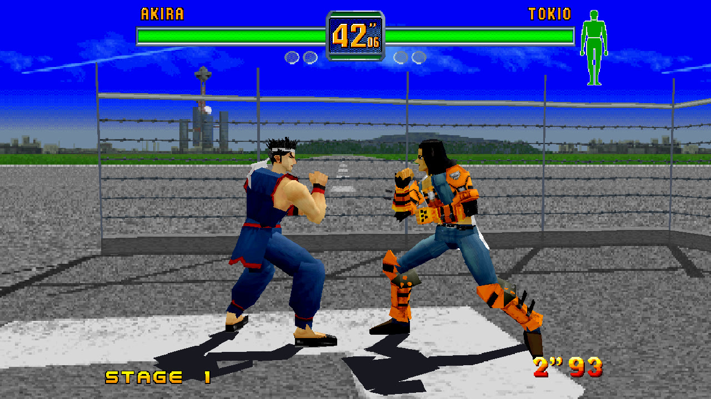

# The picture

## High resolution

The polygons are drawn by your graphics card at the window's resolution instead of the Saturn's. It's a switch on
the launcher's first page, on unless you switch it off (off: the original's resolution). On Linux and Windows it
needs a Vulkan driver.

## Widescreen

**16:9**, with more of the arena at the sides. It's a switch on the launcher's first page, and on the in-game menu's
Display page while playing (from the next frame). It needs high resolution, and is off unless you switch it on.

It works in the fights seen so far; the other screens have not been checked in it. The gauges and names are not
moved out to the picture's edges yet, as Fighting Vipers' are ([ROADMAP.md](ROADMAP.md)).

## Display

The Display page (in the launcher and the in-game menu) says how the picture fits the window or screen. The first
choice of each is how the port always drew it.

| Row | Choices |
| --- | --- |
| Scaling | Sharp, as large as fits; Whole pixels, as tall as a whole number of the Saturn's lines fits, with a border round it; Smooth (with high resolution off, the Saturn's picture softened up to the size) |
| Picture shape | 4:3, as a television showed it (16:9 in widescreen); Square pixels, each pixel as wide as it is tall, a little wider; Fill, the whole window or screen |
| Shader | Off, or one of RetroArch's shaders (below) |
| Window size | 3x the Saturn's 240 lines, or 2x to 6x (the window can be made any size by dragging its edges) |

Full screen is a switch on the launcher's first page, and **F11** while playing.

## Shaders

The picture through one of RetroArch's shaders, by [librashader](https://github.com/SnowflakePowered/librashader),
at the Saturn's own resolution:

- **CRT**: a curved television. **CRT Lottes** and **CRT Guest**: flat screens, sharp and bright. **CRT Royale**: the
  closest to a real screen's glass, and the slowest. **CRT Light**: lines and a faint mask, for a slow computer.
- **Scanlines**: light, strong, as an OSSC draws them, or dark.
- **xBRZ** and **ScaleFX**: the pixels' edges made smooth lines and curves.
- **Your own**: the first RetroArch slang preset (`.slangp`) in a `shaders` folder beside the game's settings.

The picture's shape stays as set, and the menu is drawn over the picture without the shader.
